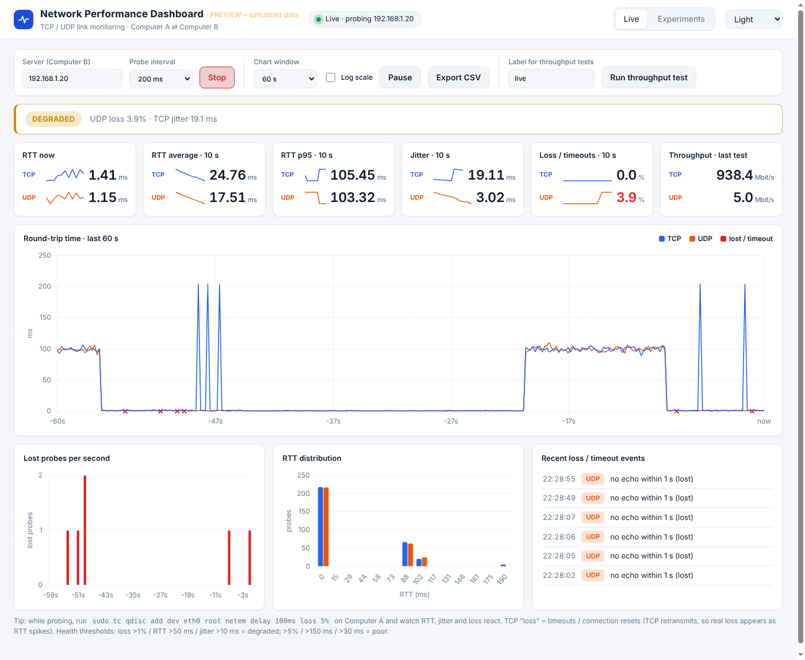
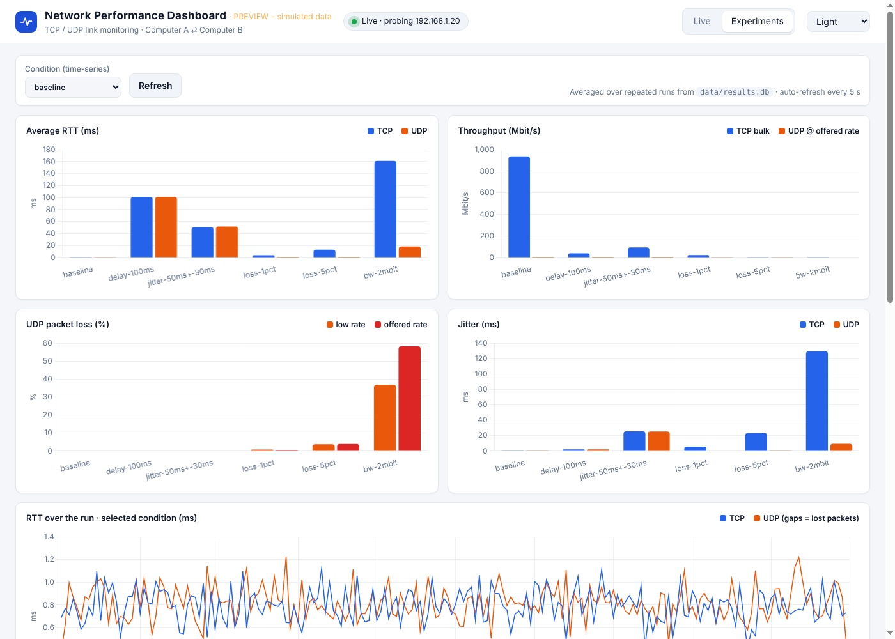

# Network Performance Dashboard

A Computer Networks (CN) semester project that **measures and compares communication between two computers
under different network conditions**, using TCP and UDP test messages, and presents the results in a
live web dashboard.

| Metric | Measured for |
|---|---|
| Round-trip time (RTT) – min / avg / p95 / max | TCP and UDP |
| Throughput | TCP bulk transfer, UDP at a fixed offered rate |
| Packet loss | UDP (missing sequence numbers); TCP via retransmission counter |
| Jitter | TCP and UDP |

Also recorded: TCP connect time, TCP retransmissions, UDP reordering and duplicates.


*Live view (preview rendered with simulated data).*


*Experiments view comparing network conditions (preview rendered with simulated data).*

## Architecture

```
Computer A (client + dashboard)                    Computer B (server)
┌───────────────────────────────┐   TCP :5001     ┌────────────────────┐
│ client/test_runner.py         │ ───────────────►│ server/            │
│   RTT, throughput, loss,      │   UDP :5002     │   echo_server.py   │
│   jitter  ──► data/results.db │ ◄───────────────│ (TCP + UDP echo)   │
│ dashboard/app.py (Flask)      │                 └────────────────────┘
│   live probing + charts       │
└───────────────────────────────┘
```

Every message carries `[seq (4 B) | client send timestamp (8 B) | padding]`. The server simply echoes it back,
so RTT is computed from the **client's own clock** (no clock synchronisation needed).

## Requirements

- Two Linux machines (tested design target: Ubuntu) on the same network
- Python 3.9+ on both; `pip install -r requirements.txt` (Flask) on the machine running the dashboard
- `iproute2` (`tc`) and `sudo` on Computer A to create network conditions
- Open **5001/tcp** and **5002/udp** on Computer B:
  `sudo ufw allow 5001/tcp && sudo ufw allow 5002/udp`

## Quick start

```bash
git clone https://github.com/Muqeet04/network-performance-dashboard.git
cd network-performance-dashboard
pip3 install -r requirements.txt
```

**1. Computer B – start the echo server**
```bash
python3 server/echo_server.py
```

**2. Computer A – run one measurement**
```bash
python3 client/test_runner.py --server <IP_of_B> --condition baseline --runs 3
```

**3. Computer A – run the whole condition matrix** (applies `tc netem`, resets it afterwards)
```bash
ip a                                  # find your interface name, e.g. eth0
sudo SERVER=<IP_of_B> IFACE=eth0 PYTHON=$(which python3) ./scripts/run_matrix.sh
```

**4. Computer A – open the dashboard**
```bash
python3 dashboard/app.py              # http://localhost:8000
```

## Dashboard

- **Live tab** – enter Computer B's IP and press *Start live probe*. TCP and UDP probes run continuously and the page
  shows rolling RTT / p95 / jitter / loss KPIs (last 10 s) with sparklines, a network-health banner, a 30 s – 5 min RTT chart
  with lost-probe markers, lost probes per second, an RTT histogram and an event log. *Run throughput test* performs a 5 MB
  TCP bulk transfer and a 3 s UDP run and stores them. Chart window, log scale, pause and CSV export are available.
- **Experiments tab** – bar charts and a summary table comparing every stored condition (averaged over repeated runs),
  plus an RTT time-series for the selected condition.
- Themes: Light (default), Dark, Aurora, Terminal, Paper.

Try it live during a demo: while probing, run
`sudo tc qdisc add dev eth0 root netem delay 100ms loss 5%` on Computer A and watch RTT, jitter and loss react.
Remove it with `sudo tc qdisc del dev eth0 root`.

## How each metric is measured

| Metric | TCP | UDP |
|---|---|---|
| RTT | message echoed by the server; `now − send_timestamp` | same, per datagram (1 s timeout = lost) |
| Throughput | bulk transfer of N MB: `bytes × 8 / duration` | fixed offered rate (default 5 Mbit/s for 5 s): goodput = received bytes / time |
| Loss | hidden by retransmission → report the `RetransSegs` delta from `/proc/net/snmp` | missing sequence numbers / packets sent (round-trip loss) |
| Jitter | mean absolute difference of consecutive RTTs | same |

## Experiment matrix (`scripts/run_matrix.sh`)

| Condition | `tc netem` arguments |
|---|---|
| baseline | – |
| delay-100ms | `delay 100ms` |
| jitter-50ms+-30ms | `delay 50ms 30ms` |
| loss-1pct | `loss 1%` |
| loss-5pct | `loss 5%` |
| bw-2mbit | `rate 2mbit` |

Edit the `CONDITIONS` array in the script to add your own (payload sizes, Wi-Fi vs Ethernet, …).
Each condition is run 3 times (`RUNS=…` to change) and stored in `data/results.db` (SQLite).

## Project structure

```
.
├── server/echo_server.py        TCP + UDP echo / bulk-sink server (Computer B)
├── client/test_runner.py        measurement client, metrics, SQLite storage (Computer A)
├── scripts/run_matrix.sh        applies tc netem conditions and runs the matrix
├── dashboard/
│   ├── app.py                   Flask API + page
│   ├── live.py                  continuous TCP/UDP prober for the live view
│   └── templates/index.html     dashboard UI (Chart.js)
├── data/                        results.db is created here (git-ignored)
├── docs/                        screenshots
└── requirements.txt
```

## Limitations

- No one-way delay (would require synchronised clocks); RTT is used instead.
- TCP packet loss is inferred from the system-wide retransmission counter – keep the machines otherwise idle during a run.
- UDP loss is round-trip loss (a message lost in either direction counts).
- `tc netem` on Computer A shapes only the A → B direction (apply it on B as well for symmetric conditions).
- Results come from a controlled LAN and depend on hardware, drivers and background traffic.

## Validating the numbers

Cross-check with standard tools: `ping <IP_of_B>` (RTT), `iperf3 -c <IP_of_B>` and `iperf3 -u -b 5M -c <IP_of_B>`
(throughput, UDP loss and jitter), and inspect traffic with Wireshark.

## Author

Muqeet ([@Muqeet04](https://github.com/Muqeet04)) – Computer Networks semester project.
